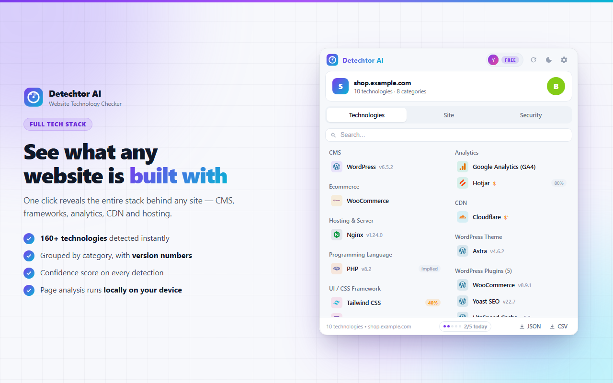
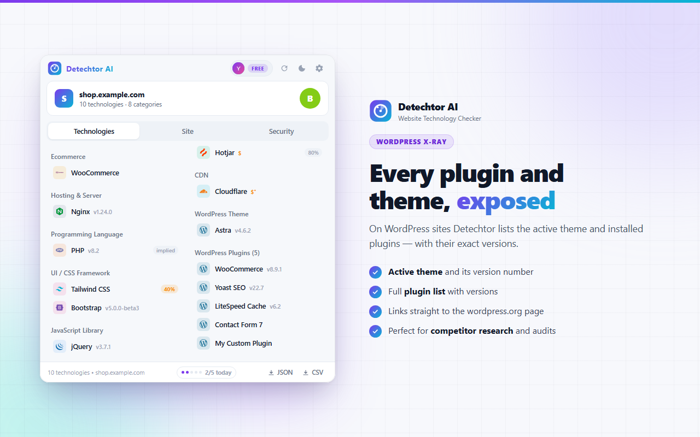
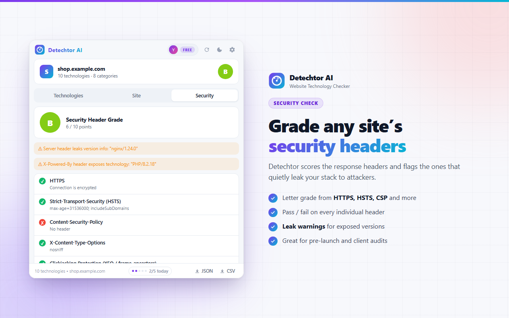

# Detechtor AI: Website Technology Checker and Tech Stack Detector for Chrome

Detechtor AI is a Chrome extension that tells you what a website is built with. Open any page, click the icon, and it lists the CMS, JavaScript frameworks, analytics tools, CDN, hosting and other technologies behind the site, shows the evidence for every match, and grades the security headers.

**[Install from the Chrome Web Store](https://chromewebstore.google.com/detail/nnhkoenmpopdhicgfmdmdjmjdoahmkpa?utm_source=github&utm_medium=readme&utm_campaign=detechtor_ai)** | **[Full guide and FAQ](https://www.addonschrome.com/extensions/detechtor-ai-website-technology-checker-tech-stack-detector.html?utm_source=github&utm_medium=readme&utm_campaign=detechtor_ai)**

This repository is the public home for Detechtor AI documentation, release notes and the issue tracker. The extension itself is distributed through the Chrome Web Store.

## What it detects

- 164 technologies in 22 categories: CMS, JavaScript frameworks, e-commerce platforms, analytics, tag managers, CDN, hosting and more
- WordPress sites: the active theme and the plugins it can see
- Security headers, graded from A+ to F
- Server, SEO and page details in one panel

## Evidence, not guesses

Detechtor AI checks 14 kinds of signals on the page. For every technology it reports, the evidence panel shows what triggered the match, so you can verify the result yourself.

## How to use it

1. Install Detechtor AI from the [Chrome Web Store](https://chromewebstore.google.com/detail/nnhkoenmpopdhicgfmdmdjmjdoahmkpa?utm_source=github&utm_medium=readme&utm_campaign=detechtor_ai).
2. Open the website you want to check.
3. Click the Detechtor AI icon in the toolbar to see the tech stack.
4. Export the result as JSON or CSV if you want to keep it or compare sites.

The [full guide](https://www.addonschrome.com/extensions/detechtor-ai-website-technology-checker-tech-stack-detector.html?utm_source=github&utm_medium=readme&utm_campaign=detechtor_ai) explains each category and the security grade.

## Who uses a tech stack detector

- Developers checking which framework or CMS a site runs on
- Agencies and freelancers researching a prospect before a pitch
- SEO and marketing teams looking at competitor tooling
- WordPress users who want to know which theme or plugin a site uses

## Privacy

Detection runs locally in your browser on the page you have open.

## Screenshots

## Support and feedback

Found a bug or want a feature? [Open an issue](../../issues) in this repository. Please include your Chrome version and the steps that led to the problem.

## Disclaimer

Detechtor AI is an independent tool. Product and company names it detects (WordPress, Shopify and others) are trademarks of their respective owners. Results are based on signals visible in the page and can miss technologies that leave no trace in the browser.

---

Built and maintained by [Addons Chrome](https://www.addonschrome.com/?utm_source=github&utm_medium=readme&utm_campaign=detechtor_ai).
